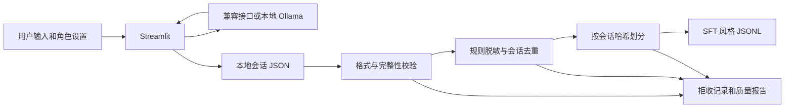

# AI Companion Data Engineering

**AI 智能伴侣与对话数据处理实践**：基于 Python、Streamlit 和兼容 Chat Completions 的 LLM 接口，实现角色配置、流式对话与本地会话管理；将对话 JSON 转换为经过结构校验、规则脱敏、去重和会话级划分的 JSONL 数据。

这个个人项目用一个具体应用串起两类能力：LLM 应用集成，以及面向对话数据的数据处理与质量核验。原型来自作者已有的 `ai_partner_01.py`，本仓库在原型上借助 AI 编程工具整理模块，并新增数据处理流程和自动化检查。原有实现与本次新增内容见 [项目演进记录](docs/project-notes.md)。

## 功能

| 模块 | 已实现内容 | 对应代码 |
| --- | --- | --- |
| LLM 交互 | 角色提示词、多轮上下文、流式输出；环境变量配置接口和模型 | `companion/llm.py` |
| 会话管理 | 新建、保存、加载、删除、下载；临时文件写入后原子替换 | `app.py`、`companion/storage.py` |
| 数据标准化 | 兼容原型字段与新字段；校验角色顺序、文本类型和完整轮次 | `companion/schema.py` |
| 数据准备 | 手机号、邮箱、`sk-` 形式密钥的规则脱敏；会话去重；SFT 风格样例导出 | `companion/pipeline.py` |
| 数据质量 | 拒收原因统计、脱敏计数、来源和输出 SHA256、确定性会话级划分 | `reports/fixture/` |
| 自动检查 | 数据处理、会话存储、流式接口协议、界面操作与错误回退 | `tests/`、GitHub Actions |

## 数据流



## 快速运行

建议使用 Python 3.12。以下命令均在仓库根目录执行。

```powershell
python -m venv .venv
.venv\Scripts\Activate.ps1
python -m pip install -r requirements-dev.txt
python -m streamlit run app.py
```

macOS / Linux 使用 `source .venv/bin/activate` 激活环境。默认是**离线演示模式**，无需账号或模型；回复是明确标识的固定模板，可检查界面与会话流程。

### 接入真实模型

复制 `.env.example` 为 `.env`，配置后在侧栏选择“真实模型”。

```dotenv
COMPANION_MODE=live
LLM_BASE_URL=http://localhost:11434/v1
LLM_MODEL=deepseek-r1:8b
LLM_API_KEY=ollama
```

本地 Ollama 需要自行安装、启动服务并准备对应模型，例如 `ollama pull deepseek-r1:8b`。模型名必须与服务中实际可用的名称一致。远程兼容服务则填写其接口地址、模型名和自己的密钥；请求会把本轮上下文发送到所配置的服务。服务协议参考 [Ollama 官方兼容接口说明](https://docs.ollama.com/api/openai-compatibility)。

新会话会记录 `source_mode`；离线演示会话在数据处理阶段被拒收，避免把固定演示回复混入训练样例。切换模式后需要新建会话。

### 运行数据处理

无需 Streamlit 或真实模型，仅用 Python 标准库即可执行：

```powershell
python -m companion.pipeline --input examples/sessions --output artifacts/example-run
```

输出包括：

- `sessions.jsonl`：标准化和脱敏后的有效会话。
- `sft_train.jsonl` / `sft_eval.jsonl`：每条样例截止于一个 assistant 回复，保留此前上下文；包含 `messages` 和追踪字段。
- `rejected.jsonl`：来源内容哈希及拒收原因，不复制原始对话。
- `lineage.jsonl`：来源内容哈希、规范化会话哈希与划分结果。
- `quality_report.json`：输入输出计数、拒收分类、脱敏计数、配置和输出文件哈希。

处理自己的会话可使用 `--input data/sessions`，输出到独立的 `artifacts/` 目录。输入、输出目录不能互相包含。同一输出目录会被本次结果覆盖，保留多次运行时应使用不同输出目录。

### 验证

```powershell
python -m pytest -q
```

流式协议检查使用本地 HTTP 模拟服务；界面检查使用 [Streamlit AppTest](https://docs.streamlit.io/develop/api-reference/app-testing/st.testing.v1.apptest)。这些检查无需真实密钥，不等于已验证真实模型的回答质量。

## 可复现的样例结果

仓库仅包含人工构造的演示数据，**不包含私人聊天记录**。`07_legacy.json` 也由脚本生成，只是展示旧格式兼容。

默认参数处理 8 份样例文件，实际得到：

| 项目 | 结果 |
| --- | ---: |
| 输入文件 | 8 |
| 保留的有效会话 | 2 |
| 拒收文件 | 6 |
| 生成的多轮样例 | 3 |
| 有效会话中替换的邮箱 / 手机号 | 1 / 1 |

拒收的 6 份分别是重复会话、空会话、错误角色顺序、未完成对话、离线演示会话和损坏 JSON。默认 20% 是哈希划分阈值；样例数量很小，当前 3 条均落入 train，eval 为 0，不能理解为精确的 80/20 比例。边界划分与确定性由测试覆盖。查看 [实际输出与质量报告](reports/fixture/quality_report.json)。

## 适用范围

- 这是单机、单用户的个人作品原型，没有登录鉴权或用户间隔离，适合本地运行与学习。
- 数据处理采用完整会话级的精确去重，不包含语义去重；相似或部分重叠的会话仍可能跨集合，需要在真实任务中进一步检查。
- 脱敏规则只覆盖指定格式，不能保证发现姓名、地址、身份证号或所有密钥形式；对真实数据仍需结合权限、用途和人工检查。
- 导出的 JSONL 是数据准备产物，尚未训练或微调模型；追踪字段应按目标训练工具要求映射，不宣称可直接上传到任意平台。
- 当前没有 RAG、向量数据库、Agent 工具调用、分布式任务调度或生产级监控。没有测量真实模型的准确率、延迟或业务效果。

## 项目介绍与岗位对应

- [原型梳理、改进点和当前边界](docs/project-notes.md)
- [AI 数据工程岗位能力对应与简历表述](docs/job-fit.md)
- [项目讲解与动手练习](docs/interview-guide.md)

此项目适合与 SQL / 数仓项目一起展示：前者体现对话数据和 LLM 接口实践，后者体现结构化数据建模与加工能力。
